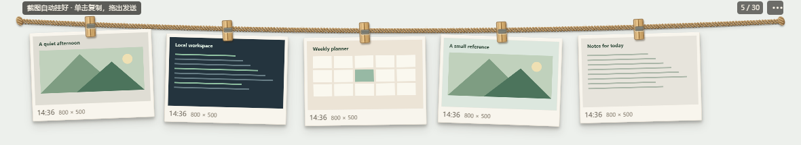

# 截图晾衣绳 · Capture Shelf

把最近的截图夹在桌面上的一根麻绳上，需要时拖进聊天窗口或文件上传区域。截图和设置只保存在本机，无账号、无云同步。



## 下载与安装

在 [Releases](https://github.com/sym611030/capture-shelf/releases/latest) 下载对应系统的文件；安装版和便携版都自带运行时，不需要 Node.js。

- **Windows 10 22H2 / Windows 11，64 位**：下载 `Capture-Shelf-版本-windows-x64-setup.exe`，双击安装，可选择目录；安装后从“截图晾衣绳”快捷方式打开。`portable.exe` 是免安装版。
- **macOS 13+，Apple Silicon**：下载 `macos-arm64.dmg`，打开后把应用拖入 Applications。
- **macOS 13+，Intel**：下载 `macos-x64.dmg`，安装方式相同。

当前安装包未做商业代码签名或 Apple 公证。Windows 可能显示未知发布者；macOS 可能要求在“系统设置 → 隐私与安全性”允许打开。macOS 包由 GitHub 的 Mac 环境构建，尚未完成真实 Mac 设备及第三方聊天客户端验收。

## 使用

首次启动先选择是否自动收集剪贴板图片和截图目录新文件。系统无法区分截图和普通复制的图片；剪贴板收集可随时关闭。

- Windows 用 `Win + Shift + S` 截图；macOS 的系统截图可从默认桌面或配置的截图目录进入应用，复制到剪贴板的图片也可收集。
- 单击图片复制，双击打开原图；拖动图片向支持文件拖放的应用发送 PNG。不接受拖放的输入框可用 `Ctrl/Cmd + V` 粘贴。
- 拖动绳子上方的小提示或左端绳结移动窗口；图片多时用滚轮横向浏览。
- 右上角 **…** 菜单包含导入图片、回收区、暂停收集、置顶和设置。
- `Ctrl/Cmd + Shift + Space` 显示或隐藏；关闭窗口后仍在托盘运行，退出可用托盘或设置菜单。
- 默认保留 30 张，新增时最旧图片进入回收区；回收区保留 100 张或 7 天，先到者生效，过期永久删除。
- 空绳高约 80px，默认图片尺寸下约 215px；窗口宽度和缩略图大小可调整。

目录监听只接收新图片，旧文件可手动导入。macOS 的桌面等受保护目录可能要求文件访问权限，可在系统设置授权。卸载默认保留本地截图；数据目录可从 **… → 设置 → 打开数据目录** 查看并自行备份或删除。

文件拖放是否成功取决于目标应用是否接受图片文件。Windows 已验证独立 Edge 浏览器上传框，微信、飞书、QQ、Slack 和 macOS 实机仍需分别验证。

## 开发

需要 Node.js 22.13 或更新版本及 npm。

```sh
npm ci
npm run dev
```

技术栈：Electron、TypeScript、React、SQLite、本地 PNG。主进程负责存储、捕获、窗口和原生拖放；渲染进程使用受限 IPC，启用上下文隔离与沙箱，打包版禁止渲染进程网络请求。

```sh
npm test
npm run build
npm run test:e2e
```

单元测试覆盖回收、恢复、文件过滤和窗口边界；Electron 冒烟测试在隔离数据目录使用合成图片，验证捕获去重、30 张回收、重启持久化、拖放文件准备、设置、IPC 和紧凑布局，不读取系统剪贴板。

Windows 原生手势和真实剪贴板回归需显式运行，脚本临时备份并恢复剪贴板：

```sh
node scripts/desktop-regression.cjs --live-clipboard
```

`CAPTURE_SHELF_DATA` 可指定本地数据目录；默认使用 Electron 的系统用户数据目录。`CAPTURE_SHELF_TEST=1` 和 `CAPTURE_SHELF_TEST_DATA` 仅在开发版启用隔离测试，测试或预览模式不收集系统剪贴板。

## 构建与发布

```sh
npm run package:win
npm run package:mac
```

Windows 生成 NSIS 安装版和便携版；macOS 在 Mac 上生成 Intel 与 Apple Silicon DMG。产物写入 `outputs/release/`，不提交到源码仓库。

推送 `v版本号` 标签会在 GitHub Actions 的 Windows/Mac 环境执行测试和打包，再将安装文件和 `SHA256SUMS.txt` 发布到 GitHub Releases。仓库不包含截图数据库、个人设置、签名证书或本机启动脚本。

## License

[MIT](LICENSE)